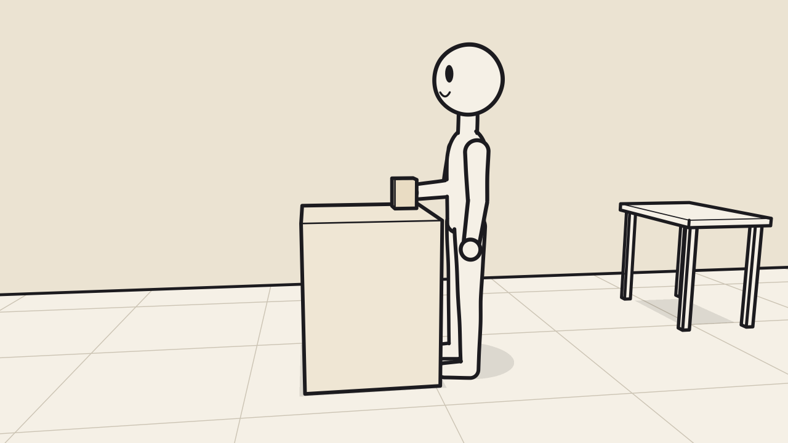

# Mavian

**Animation scenes written in Python, evaluated and rendered in Rust.**

Mavian is an engine for creating stylized 3D animation from code.
Describe characters, poses, movement, cameras and object interactions in a
Python shot file, then render it to PNG frames and an MP4 video.

The renderer combines 3D geometry with expressive outlines, flat fills,
hand-drawn line variation and stylized effects.



*A frame from [interact.py](shots/interact.py), rendered on the GPU.*

## Features

- **Rigged characters:** built-in stick figure, mannequin and fighter models;
  reusable poses, pose tracks, walking, jumps and foot planting.
- **Object interactions:** grabbing, carrying, placing and pushing props;
  prioritized limb contacts, inverse kinematics and prop-clearance checks.
- **Explicit assistance:** optional torso adjustment and bounded preparatory
  steps, with a pose lock for precise authoring.
- **Camera choreography:** fixed and orbit cameras, cuts, joint tracking,
  smoothing, fisheye projection and camera shake.
- **Drawing controls:** line boil, pressure variation, held drawings, facial
  features, shadows, attached wire geometry and depth-aware fire effects.
- **Multiple output paths:** a Vulkan GPU renderer, a CPU reference renderer,
  SVG sketches and vector line export.
- **Repeatable evaluation:** seeded drawing effects, arbitrary-time frame
  sampling, frame caching and CPU/GPU regression comparisons.

Mavian is under active development. APIs and animation behavior may change.
The current implementation is kinematic; it is not a general rigid-body or
balance simulator.

## Build and render

### Requirements

Development currently targets Linux. You will need:

- A recent Rust toolchain with Cargo and Rust 2024 support.
- CPython 3, including development headers and a shared `libpython`, for the
  embedded interpreter.
- A native compiler/linker toolchain.
- A Vulkan-capable GPU and driver for GPU rendering. CPU rendering is available
  with `--cpu`.
- `ffmpeg` with the `libx264` encoder for MP4 output and contact sheets.
- `rsvg-convert` from librsvg for SVG rendering and overlays, including labels,
  contact diagnostics, sketches and fire composition.

Make `python3`, `ffmpeg` and `rsvg-convert` available on `PATH`.
If multiple Python installations are present, select one at build time with
`PYO3_PYTHON=/path/to/python3`.

### Quick start

From the repository root:

```sh
cargo build --release -p mavian-cli
./target/release/mavian render shots/interact.py
```

By default, rendering uses the low-power GPU adapter. To use a different path:

```sh
./target/release/mavian render shots/interact.py --cpu
./target/release/mavian render shots/interact.py --gpu high-performance
```

The low-power path avoids loading NVIDIA's Vulkan driver by default. Use
`--gpu high-performance` when requesting an NVIDIA or discrete adapter.

The default output is:

```text
out/interact/
├── png/             # Numbered PNG frames
├── interact.mp4     # H.264 video
└── sheet.png        # Overview of sampled frames
```

Rendering a shot again replaces its output directory and reuses matching frames
from `out/.cache`. Set `MAVIAN_OUT` to choose another output root.
Use `--no-video` to skip video and contact-sheet generation.

The `mavian` Python module is embedded in the executable. Load shot files
through the CLI; a separate `pip install mavian` is not part of this workflow.

## Write a shot

Save this as `shots/hello.py`:

```python
from mavian import Actor, Ground, MANNEQUIN, Shot, Style, Watch, keys, walk

hero = Actor(
    MANNEQUIN,
    path=(0.0, -1.0),
    poses=keys(walk(0.0, steps=4, step=0.5, stop="stand")),
)

shot = Shot(
    actors=[hero],
    camera=Watch(pos=(3.0, 1.8, 4.2), target=(0.0, 0.9, 0.2), fov=40),
    ground=Ground(grid=False),
    style=Style(boil=0.8),
    fps=24,
    length=3.0,
    draw_on=2,
    size=(1280, 720),
)
```

Then render it:

```sh
./target/release/mavian render shots/hello.py
```

A shot file defines `shot`. It can also define a `variants` dictionary mapping
names to alternative shots. `draw_on=2` holds each character drawing for two
output frames; `draw_on=1` updates it every frame.

## Explore the examples

| Shot | What it demonstrates |
| --- | --- |
| [three_cams.py](shots/three_cams.py) | Walking, camera cuts, fisheye and a jump past the camera |
| [jump.py](shots/jump.py) | Jump planning, flight, landing and pose variants |
| [interact.py](shots/interact.py) | Picking up a cup, carrying it, placing it on a crate and pushing the crate |
| [fight.py](shots/fight.py) | Strikes, guards, misses, recoil and impact timing |
| [fire.py](shots/fire.py) | Stylized fire, sparks and depth composition |
| [contacts.py](shots/contacts.py) | Support constraints, contact residuals and explicit torso assistance |
| [approach.py](shots/approach.py) | Preparatory steps, blocked paths, distance budgets and pose locking |

Select a variant with `-v`, or render every variant with `--all`:

```sh
./target/release/mavian render shots/interact.py -v wide
./target/release/mavian render shots/contacts.py --all --contacts
```

## Keep control of the animation

Automatic adjustments are configurable rather than an implicit replacement
for authored poses.

| Option | Default | Behavior |
| --- | --- | --- |
| `Actor(..., body_reach=20.0)` | `0.0` | Permits bounded torso assistance for hand contacts; the value is an angle in degrees |
| `Actor(..., pose_lock=True)` | `False` | Preserves the sampled pose against IK, prop avoidance and preparatory steps |
| `grab(..., auto_step=0.25)` / `push(..., auto_step=0.25)` | `0.0` | Permits a preparatory step with a maximum horizontal translation in metres |
| `step_duration=0.9` on `grab` or `push` | `0.8` seconds | Sets the preparation duration before the hand starts reaching |

Limb IK and prop-clearance corrections remain active by default. Use
`pose_lock=True` to prevent those adjustments.

Pose locking preserves the animation of pose keys, paths and explicitly
configured squash/stretch; it does not freeze the actor in time.

Preparatory steps require a suitable stationary interval. They can be refused
because of authored motion, reserved contacts, insufficient time or an obstacle.
The resulting horizontal offset persists in subsequent motion. Inspect the
decision with the `steps` command.

`grab` attaches only when the final hand reaches the selected surface anchor at
`at` (within 2 mm) and the grabbing arm has no prop penetration deeper than
1 mm. The decision is compiled once, so reverse and isolated frame rendering
produce the same binding. A missed grab leaves the prop in its previous motion;
a later release without a successful binding does nothing. An occupied hand or
already-held prop cannot acquire a second binding. `at` remains the authored
acquisition instant; no automatic waiting or retiming is added.

Grab and placement transitions use fixed wrist endpoints sampled from the
animated, deformed pose. Difficult prop-action intervals receive a deterministic
arm route with sampled clearance against props, the torso and the head. The
held item's volume can lift the wrist above a support without sliding the grip.
Automatic `onto=prop` placement accounts for the item's yawed footprint and grip
offset; explicit point targets keep their authored coordinates.

Contact diagnostics distinguish satisfied, blending, unreachable, conflicting,
invalid and obstructed goals. `volume:` and `self:` entries identify unresolved
held-item and arm/body penetration. A failed target is reported rather than silently
stretching the limb to reach it.

## Rendering and diagnostics

```sh
# Show contact targets and residuals; also write contacts.csv
./target/release/mavian render shots/contacts.py --contacts

# Inspect contacts, preparation and acquisition decisions without rendering
./target/release/mavian contacts shots/interact.py
./target/release/mavian steps shots/approach.py
./target/release/mavian grabs shots/interact.py

# Render the acquisition regression with diagnostics
./target/release/mavian render shots/grasp.py --contacts

# Render the sketch layer, or export vector lines alongside the usual output
./target/release/mavian render shots/interact.py --layers sketch
./target/release/mavian render shots/interact.py --vector

# Inspect the frame-input digest or compare GPU output with the CPU reference
./target/release/mavian digest shots/three_cams.py
./target/release/mavian compare shots/interact.py
```

`grabs` prints each acquisition decision and its residual, including failed
attempts after the reach has ended. `render --contacts` also saves `grabs.csv`.
The permanent `grasp.py` fixture has `far`, `locked` and `blocked` variants.

`--vector` writes SVG lines to `out/<shot>/lines/`. Sketch mode uses an SVG
rendering path and produces PNG/video output through the usual pipeline.
`mavian list` lists the built-in Rust shots; the Python examples are in `shots/`.

## Project structure

| Location | Responsibility |
| --- | --- |
| [crates/core](crates/core), [crates/graph](crates/graph) | Math, time, seeded noise, fingerprints and caching |
| [crates/rig](crates/rig), [crates/models](crates/models) | Skeletons, poses and built-in character models |
| [crates/scene](crates/scene) | Actors, cameras, actions, contacts, props and effects |
| [crates/frame](crates/frame) | Shared frame geometry and drawing inputs |
| [crates/gpu](crates/gpu), [crates/cpu](crates/cpu), [crates/render](crates/render) | GPU rendering, CPU reference rendering and SVG output |
| [crates/py](crates/py), [crates/cli](crates/cli) | Embedded Python API and command-line interface |
| [crates/check](crates/check), [crates/shots](crates/shots) | Validation and Rust reference shots |
| [shots](shots) | Executable Python scene descriptions |

## Development

```sh
cargo test --release --workspace -- --test-threads=1
cargo clippy --workspace --all-targets -- -D warnings
```

Regression tests exercise the original interaction and fight shots, support
anchors, bone lengths, collision checks, authoring permissions, repeatable
sampling and CPU/GPU agreement. GPU tests may return early when no usable
adapter is available; use a real Vulkan adapter when validating renderer changes.
CPU and GPU output can differ slightly at rasterization boundaries.

## Current limitations

- Acquisition is checked at the authored instant, without a search for a later
  contact or finger-level grip simulation. Later actions that invalidate an
  earlier verified acquisition are rejected during compilation; separate their
  contact intervals.
- Release and sliding remain scheduled by authored times. Successful placement
  and pushing are not yet gated by actual support or palm contact.
- Preparatory motion is a bounded step with a trailing-foot follow. It does
  not navigate around obstacles, plan multiple steps or simulate balance.
- Clearance checks use conservative primitives and sampled trajectories.
  Arm/body correction applies to prop-action arms; free authored animation is
  diagnosed without adding general full-body collision response. Proximal
  shoulder tissue is excluded from the arm/torso proxy check. This is not a
  rigid-body simulation or continuous collision detection for arbitrary geometry.
- A difficult prop-action interval must have a connected route in the sampled
  configuration graph; compilation reports an error if it cannot find one.
- Some strike poses and contact transitions still need visual refinement.
  The API and renderer are experimental, with Linux as the current development
  platform.
